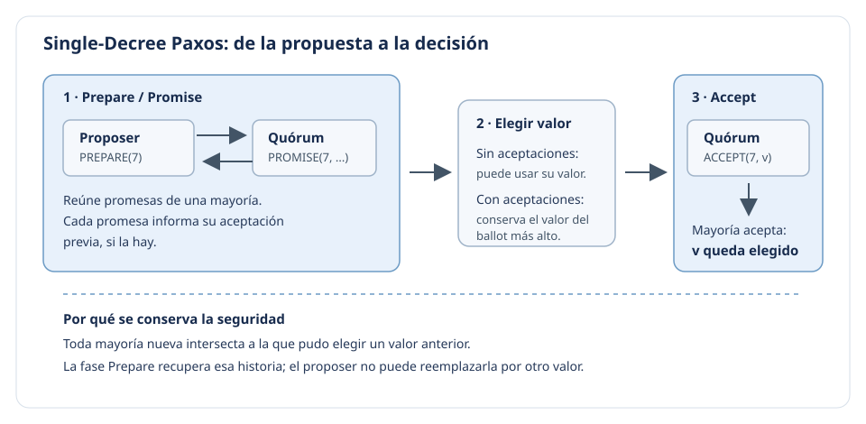

# Paxos: cómo alcanzar consenso en un sistema distribuido


Imaginemos un servicio replicado en tres nodos. Cada nodo puede recibir comandos de distintos clientes y, ante una misma posición del registro, aparecen tres propuestas: `SET x = 1`, `SET x = 2` y `SET x = 3`.

El problema no es que los tres nodos reciban el mismo mensaje al mismo tiempo. Tampoco alcanza con que cada uno decida por su cuenta. **Necesitamos que, aun cuando haya caídas o demoras en la red, no puedan elegir valores incompatibles para una misma decisión.**

Esa es la pregunta que intenta responder **Paxos**, el algoritmo de consenso distribuido desarrollado por Leslie Lamport. Aunque suele presentarse como un protocolo difícil de comprender, su idea central puede resumirse en dos elementos: **mayorías que se intersectan** y **reglas que impiden olvidar decisiones anteriores**.

En este artículo vamos a recorrer **Single-Decree Paxos** (la elección de un único valor), entender por qué funciona y extender la idea a **Multi-Paxos**, que permite mantener un registro de comandos replicado.

## ¿Qué significa alcanzar consenso?

En un sistema distribuido, distintos procesos pueden observar distintos estados de la red. Un mensaje puede llegar tarde a un nodo, perderse para otro o quedar pendiente mientras uno de los participantes se reinicia.

Aun así, un protocolo de consenso busca satisfacer tres propiedades:

- **Acuerdo (agreement):** dos procesos que deciden no pueden decidir valores distintos para la misma instancia de consenso.
- **Validez (validity):** el valor elegido debe proceder de alguna propuesta válida; el protocolo no lo inventa arbitrariamente.
- **Terminación (termination):** bajo determinadas condiciones de progreso, los procesos participantes llegan finalmente a una decisión.

Conviene distinguir desde el comienzo dos conceptos:

- **Safety** significa que nunca ocurre algo incorrecto: no se eligen dos valores diferentes.
- **Liveness** significa que eventualmente ocurre algo deseado: el protocolo consigue avanzar.

Paxos está diseñado para preservar **safety** incluso durante largos períodos de inestabilidad. En cambio, el progreso requiere condiciones adicionales.

## El modelo de fallas

Paxos clásico está pensado para un entorno donde los procesos pueden fallar por detención (**crash**) y, en variantes con recuperación, reiniciarse. La red puede retrasar, perder, duplicar o reordenar mensajes.

El algoritmo **no presupone que los relojes físicos estén sincronizados** ni que podamos distinguir perfectamente entre un nodo caído y otro que responde demasiado lentamente.

Hay, sin embargo, dos límites importantes:

- No tolera comportamientos **bizantinos** arbitrarios: se supone que los participantes siguen las reglas del protocolo.
- Para seguir avanzando necesita comunicarse con un quórum de aceptadores. Si se pierde esa posibilidad, el sistema puede dejar de tomar decisiones, aunque las decisiones ya tomadas continúan siendo seguras.

Cuando admitimos reinicios, la información crítica de los aceptadores debe almacenarse de forma duradera; de lo contrario, un proceso podría olvidar una promesa o una propuesta aceptada.

## Los tres roles de Paxos

Paxos define tres roles lógicos. No tienen por qué corresponderse con tres máquinas distintas: un mismo proceso puede implementar varios roles.

- **Proposer:** intenta que se elija un valor. Para ello utiliza un identificador de propuesta o **ballot**.
- **Acceptor:** participa en la votación. Registra promesas y aceptaciones conforme a las reglas del protocolo.
- **Learner:** obtiene información suficiente para saber qué valor fue elegido.

La distinción entre **aceptar** y **aprender** una decisión es fundamental: un valor puede haber sido elegido por los aceptadores aunque todavía ningún cliente ni learner lo sepa.

## Los quórums y su intersección

Supongamos que hay cinco aceptadores: `A1`, `A2`, `A3`, `A4` y `A5`.

Una mayoría requiere tres aceptadores. Dos conjuntos de tres miembros, tomados de un universo de cinco, necesariamente tienen al menos un miembro en común.

```text
Aceptadores:  A1  A2  A3  A4  A5

Quórum Q1:   A1  A2  A3
Quórum Q2:       A2      A4  A5

Intersección: A2
```

Para `N` aceptadores, un quórum mayoritario tiene tamaño `⌊N/2⌋ + 1`. En un despliegue de `2f + 1` aceptadores, pueden quedar fuera de servicio hasta `f` y todavía mantenerse una mayoría disponible.

¿Por qué no aceptar simplemente a la mitad? Porque, frente a una partición, dos grupos disjuntos podrían elegir valores distintos sin conocer lo que hizo el otro. La intersección de quórums es el puente que permite preservar las decisiones.

Pero la intersección, por sí sola, no alcanza. También necesitamos que los aceptadores recuerden qué prometieron y qué aceptaron.

## Los números de propuesta (**ballots**)

Cada intento de propuesta lleva un número único y totalmente ordenado, que llamaremos `n`. Una forma habitual de generarlo es utilizar el par `(contador, identificador_del_proposer)`, ordenado lexicográficamente.

Un ballot mayor puede desplazar a uno anterior. Sin embargo, hay una diferencia crucial:

> **Importante:** El número de ballot determina qué propuestas tienen prioridad, **no** qué valor puede elegirse libremente.

Un proposer con un ballot alto no está autorizado a ignorar la historia de los aceptadores. Precisamente, la primera fase de Paxos existe para consultar esa historia.

## Single-Decree Paxos: las dos fases

Single-Decree Paxos resuelve una única instancia de consenso: elegir **un valor** para **una decisión**.

El intercambio normal se divide en dos fases:

1. `Prepare` / `Promise`
1. `Accept` / `Accepted`

<figure>
  
  <figcaption>La fase 1 recupera la historia de un quórum; la fase 2 consigue que un quórum acepte el valor.</figcaption>
</figure>

### Fase 1: Prepare y Promise

El proposer selecciona un número de ballot nuevo, por ejemplo `7`, y envía:

```text
PREPARE(7)
```

Cuando un acceptor recibe el mensaje, comprueba si ese ballot es mayor que el último al que se comprometió. Si es así:

1. Guarda de forma duradera `promised_ballot = 7`.
1. Promete no aceptar propuestas con ballots inferiores.
1. Responde con su última propuesta aceptada, si existe: `(accepted_ballot, accepted_value)`.

Una respuesta puede verse de esta manera:

```text
PROMISE(7, accepted = (4, X))
```

Si el acceptor todavía no había aceptado ningún valor, responde indicando que no tiene una propuesta aceptada. Un `PREPARE` con un ballot obsoleto puede rechazarse o ignorarse; la implementación también puede tratar de manera idempotente las retransmisiones del mismo ballot.

El proposer debe reunir respuestas de una mayoría antes de pasar a la siguiente fase.

### ¿Qué valor puede proponer?

Aquí aparece la regla más importante del protocolo.

Una vez reunidas las respuestas del quórum, el proposer examina las propuestas aceptadas que le informaron:

- Si **ningún** acceptor del quórum había aceptado un valor, puede utilizar el valor que quería proponer originalmente.
- Si **alguno** había aceptado algo, debe elegir el valor asociado al **ballot aceptado más alto** entre las respuestas.

Por ejemplo, si recibe:

```text
A1 -> PROMISE(7, accepted = (3, X))
A2 -> PROMISE(7, accepted = (5, Y))
A3 -> PROMISE(7, accepted = none)
```

entonces debe continuar con `Y`, porque `5` es el mayor ballot aceptado que apareció en el quórum. No puede escoger `X` solo porque le resulte más conveniente, ni inventar `Z`.

Esta restricción es lo que permite que una propuesta posterior no contradiga un valor que ya haya sido elegido.

### Fase 2: Accept y Accepted

Una vez determinado el valor, el proposer envía:

```text
ACCEPT(7, Y)
```

Un acceptor puede aceptar la propuesta siempre que no haya prometido previamente un ballot mayor que `7`. Si la acepta, almacena de forma duradera el ballot y el valor, y envía una confirmación:

```text
ACCEPTED(7, Y)
```

**Un acceptor aislado no decide.** Una propuesta `(n, v)` queda **elegida** cuando un quórum mayoritario de aceptadores la ha aceptado.

Luego los learners pueden enterarse de ese hecho, por ejemplo al recibir confirmaciones suficientes o a través de un mecanismo de notificación del proposer.

## Un intercambio completo de mensajes

En un caso sencillo con tres aceptadores, un proposer `P` intenta elegir `X` usando el ballot `7`. Supongamos que nadie había aceptado valores anteriores y que `A1` y `A2` responden.

```text
P                      A1                 A2                 A3
|                      |                  |                  |
|-- PREPARE(7) ------->|                  |                  |
|-- PREPARE(7) -------------------------->|                  |
|                      |                  |                  |
|<-- PROMISE(7, none)--|                  |                  |
|<--------------------- PROMISE(7, none)--|                  |
|                      |                  |                  |
|-- ACCEPT(7, X) ----->|                  |                  |
|-- ACCEPT(7, X) ------------------------>|                  |
|                      |                  |                  |
|<-- ACCEPTED(7, X) ---|                  |                  |
|<--------------------- ACCEPTED(7, X) ---|                  |
|                      |                  |                  |
|             X fue elegido: 2 de 3 aceptaron                |
```

No hace falta que `A3` reciba la propuesta para que `X` haya sido elegido. Tampoco hace falta que un cliente haya recibido ya una respuesta. **Elección** y **conocimiento de la elección** son hechos diferentes.

## ¿Por qué dos propuestas no pueden elegir valores distintos?

La intuición de la prueba de seguridad combina dos propiedades:

1. Toda mayoría futura se intersecta con la mayoría que eligió un valor anterior.
1. Un nuevo proposer debe respetar el valor del ballot aceptado más alto que encuentra durante `Prepare`.

Supongamos que, con tres aceptadores, `A` y `B` aceptaron `(5, X)`. Por lo tanto, `X` ya fue elegido.

Un segundo proposer inicia `PREPARE(9)` y obtiene respuestas de `B` y `C`:

```text
B -> PROMISE(9, accepted = (5, X))
C -> PROMISE(9, accepted = none)
```

Aunque el segundo proposer quisiera elegir `Y`, está obligado a enviar `ACCEPT(9, X)`. El mayor ballot aceptado que observó contiene `X`.

El razonamiento general se extiende también a situaciones con más ballots intermedios: mediante inducción, la regla de selección de valor preserva el valor ya elegido incluso si alguna respuesta refleja una aceptación posterior. **Pueden elegirse propuestas con ballots distintos, pero no con valores distintos para la misma instancia.**

El protocolo no depende de que todos conozcan la decisión anterior; depende de la intersección de quórums y de la información que conservan los aceptadores.

## ¿Qué pasa cuando hay fallas?

### El proposer se cae

Si `A` y `B` ya aceptaron `(5, X)` en un sistema de tres aceptadores, `X` sigue elegido aunque el proposer se caiga antes de avisarlo. Un nuevo proposer puede descubrir esa historia usando un ballot más alto.

Si una propuesta todavía no reunió una mayoría, la situación es diferente: un nuevo proposer puede terminar eligiendo otro valor, siempre que respete las respuestas obtenidas en su fase `Prepare`.

### Un acceptor se reinicia

Para que las garantías anteriores sobrevivan a reinicios, un acceptor debe conservar al menos:

```text
promised_ballot
accepted_ballot
accepted_value
```

El estado prometido evita volver a aceptar ballots inferiores. El estado aceptado permite que un proposer nuevo descubra información relevante para la seguridad.

Si estos datos se pierden tras una caída, ya no podemos aplicar sin más las garantías de Paxos con recuperación.

### Se produce una partición de red

Con cinco aceptadores, un grupo de tres puede seguir alcanzando una mayoría. Un grupo aislado de dos no puede elegir valores por su cuenta.

Esto puede reducir la disponibilidad durante la partición, pero evita que dos grupos incompatibles confirmen decisiones distintas.

## Proposers concurrentes: seguridad sin progreso

Imaginemos dos proposers, `P` y `Q`.

1. `P` obtiene promesas para el ballot `7`.
1. `Q` inicia un ballot mayor, `8`, y algunos aceptadores prometen `8`.
1. Cuando llega el `ACCEPT(7, X)` de `P`, esos aceptadores lo rechazan.
1. `P` reintenta con `9`, mientras `Q` puede pasar a `10`.

Nada obliga a que los dos dejen de competir. Pueden desplazar las propuestas del otro indefinidamente, sin producir una decisión.

Esto no viola **safety**: no se eligieron valores incompatibles. Pero sí impide **liveness**.

Por eso las implementaciones suelen favorecer un proposer distinguido o líder relativamente estable, además de utilizar reintentos y **backoff**. Esas técnicas mejoran la probabilidad de progreso cuando la red se estabiliza; no garantizan terminación ante cualquier secuencia adversa de demoras y fallas.

### La relación con FLP

El resultado de imposibilidad FLP establece que en un sistema completamente asíncrono no se puede garantizar la terminación del consenso determinista si incluso un proceso puede detenerse.

Paxos no elude ese límite: protege la seguridad sin exigir límites conocidos para la latencia, pero necesita condiciones adicionales de estabilidad y comunicación para progresar.

## Multi-Paxos: de un valor a un log

Elegir un único valor es útil, pero una base de datos replicada o una máquina de estados necesita decidir una **secuencia** de comandos.

Por ejemplo:

```text
slot 1 -> SET x = 1
slot 2 -> ADD x, 2
slot 3 -> GET x
slot 4 -> SET y = 4
```

Podemos pensar cada posición (**slot**) como una instancia lógica de consenso. Todas las réplicas que aplican los comandos deben hacerlo en el mismo orden y con una ejecución determinista.

Si corriéramos Single-Decree Paxos desde cero para cada slot, repetiríamos muchas veces la fase `Prepare/Promise`.

Multi-Paxos aprovecha un líder estable:

1. El líder establece un ballot mediante la fase 1.
1. Mientras conserva ese liderazgo y las promesas correspondientes, propone nuevos slots principalmente con la fase 2.
1. Los aceptadores mantienen información de los valores aceptados por slot.
1. Si cambia el líder, el nuevo debe recuperar la información relevante y preservar las decisiones anteriores.

```text
Single-Decree Paxos (inicio de una instancia)
  PREPARE -> PROMISE -> ACCEPT -> ACCEPTED

Multi-Paxos (líder ya establecido, slot nuevo)
                      ACCEPT -> ACCEPTED
```

Este esquema describe la optimización habitual, no todos los mensajes de una implementación completa: todavía hay que informar los valores elegidos, responder a clientes y resolver cuestiones de recuperación.

### Consenso no es lo mismo que replicación de estado

Elegir los comandos de un log es una parte del problema. Para construir una máquina de estados replicada también hacen falta reglas para:

- Aplicar comandos de manera determinista y en orden de slot.
- Tratar duplicados y reintentos de solicitudes de clientes.
- Recuperar slots incompletos después de un cambio de líder.
- Persistir y compactar el log, por ejemplo mediante **snapshots**.
- Gestionar cambios de membresía de manera segura.

Son responsabilidades adicionales que no quedan resueltas automáticamente por una explicación de Single-Decree Paxos.

## Paxos, Raft y Two-Phase Commit no resuelven exactamente el mismo problema

### Paxos y Raft

**Raft** es otro algoritmo de consenso utilizado para replicar una secuencia de entradas. Organiza explícitamente la elección de un líder, los términos y las reglas de replicación y compromiso del log.

Paxos suele presentarse primero como un protocolo para un único valor; **Multi-Paxos** lo extiende y optimiza para una secuencia. Ambos pueden servir como base de una máquina de estados replicada, aunque tienen distintas estructuras y reglas operativas.

### Paxos y 2PC

**Two-Phase Commit** (`2PC`) busca coordinar el **commit atómico de una transacción** entre participantes. Sus fases de preparación y confirmación responden a ese objetivo; el protocolo clásico puede quedar bloqueado si falla su coordinador en un momento crítico.

Paxos, en cambio, busca que un conjunto de nodos acuerde un valor de manera segura, aun frente a caídas y cambios de proposer, siempre que se respeten las reglas del protocolo. No conviene confundir las fases de Paxos con las de 2PC solo porque ambos utilizan mensajes de preparación.

## Errores frecuentes al estudiar Paxos

- **«Gana la primera propuesta que llega».** No. Los ballots y las promesas pueden impedir que esa propuesta alcance una mayoría.
- **«Una promesa equivale a aceptar un valor».** No. `PROMISE` compromete al acceptor respecto de los ballots; `ACCEPTED` confirma una aceptación.
- **«Si se eligen dos ballots, se eligieron dos valores».** No. Dos propuestas elegidas pueden tener ballots diferentes y el mismo valor.
- **«Basta con un nodo vivo para seguir decidiendo».** No. Se necesita un quórum.
- **«Paxos necesita relojes sincronizados».** No. La corrección se basa en el orden de los ballots y en los quórums, no en timestamps físicos.
- **«Cuando el proposer falla, se pierde la decisión».** No, si una mayoría ya aceptó el mismo ballot y valor, la decisión sigue siendo válida.

## Un ejercicio para comprobar la idea

Consideremos tres aceptadores `A`, `B` y `C`. `A` y `B` aceptaron `(5, X)`.

Un nuevo proposer ejecuta `PREPARE(9)` y recibe:

```text
B -> PROMISE(9, accepted = (5, X))
C -> PROMISE(9, accepted = none)
```

**Pregunta:** ¿puede enviar `ACCEPT(9, Y)`?

**Respuesta:** No. Como `B` y `C` forman un quórum y `B` informó una propuesta aceptada `(5, X)`, el proposer debe conservar `X`. Además, `X` ya había sido elegido por la mayoría formada por `A` y `B`. El nuevo ballot podrá ser `9`, pero el valor propuesto tendrá que seguir siendo `X`.

## Conclusión

La dificultad de Paxos no está en contar votos, sino en hacer que los intentos futuros respeten lo que pudo haberse decidido antes, incluso cuando algunos nodos se caen o desconocen el resultado.

Las mayorías se intersectan, los aceptadores conservan sus promesas y aceptaciones, y los proposers deben reutilizar el valor asociado al ballot aceptado más alto que descubren durante `Prepare`. Esa combinación permite preservar **safety**.

Multi-Paxos agrega la pieza necesaria para los sistemas prácticos: repetir el acuerdo sobre múltiples slots, evitando trabajo innecesario cuando hay un líder estable. Entender la distinción entre **elegir**, **aceptar** y **aprender** un valor es un buen punto de partida para estudiar también Raft, la replicación de máquinas de estados y los límites del consenso en sistemas asíncronos.

## Referencias

- Leslie Lamport, [Paxos Made Simple](https://lamport.azurewebsites.net/pubs/paxos-simple.pdf) (2001).
- Robbert van Renesse y Deniz Altinbuken, [Paxos Made Moderately Complex](https://doi.org/10.1145/2673577) (2015).
