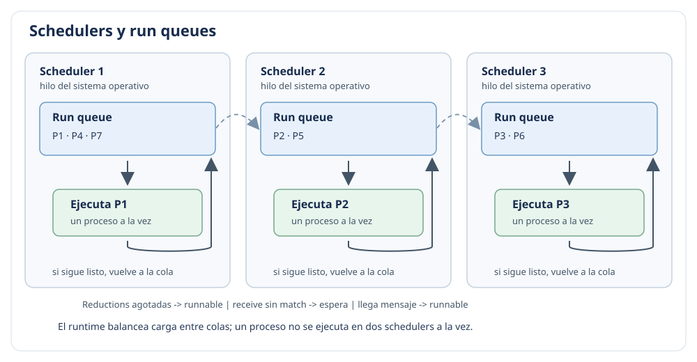
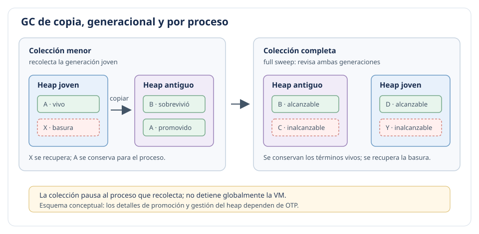

# BEAM por dentro: VM, schedulers y procesos de Elixir

Cuando escribimos código en Elixir, solemos razonar en términos de módulos, funciones, procesos y mensajes. Pero debajo de esas abstracciones hay una máquina virtual que carga módulos, administra memoria y decide qué proceso ejecuta en cada momento.

Entender algunos de esos mecanismos ayuda a explicar por qué la concurrencia de Elixir es relativamente barata, qué significa que un proceso sea liviano y qué puede salir mal cuando una tarea monopoliza el tiempo de ejecución.

Este artículo baja un nivel respecto de las abstracciones de Elixir: mira el formato de los módulos, cómo representa valores la VM, qué estado guarda un proceso y cómo los schedulers lo ejecutan. Los nombres de estructuras y varios detalles son propios de la implementación de ERTS y pueden cambiar entre versiones de Erlang/OTP.

## BEAM, Erlang/OTP y Elixir

Los nombres suelen usarse como si fueran intercambiables, pero describen piezas distintas:

- **Elixir** es un lenguaje y un conjunto de herramientas que se ejecutan sobre Erlang/OTP.
- **BEAM** es el nombre habitual de la máquina virtual de Erlang. Ejecuta módulos compilados al formato de instrucciones BEAM.
- **ERTS** (*Erlang Run-Time System*) es el sistema de ejecución que incluye el emulador BEAM y otros componentes necesarios para ejecutar una instancia de Erlang/OTP.
- **Erlang/OTP** incluye ERTS, bibliotecas y aplicaciones como `Kernel`, `stdlib` y herramientas para construir sistemas.

En un proyecto Elixir, `mix compile` compila los archivos `.ex` del proyecto a módulos BEAM. El resultado contiene instrucciones y metadatos que la VM puede cargar. En compilaciones y plataformas compatibles, el emulador también puede usar un **JIT** para traducir instrucciones BEAM a código nativo; por eso no conviene imaginar la VM como un intérprete idéntico en todas las instalaciones.

Una forma útil, aunque simplificada, de visualizar el camino es:

```text
Código Elixir
     |
     v
Compilador de Elixir
     |
     v
Módulos BEAM
     |
     v
ERTS / emulador BEAM
     |
     +-- schedulers
     +-- procesos y heaps
     +-- buzones y paso de mensajes
```

La BEAM no crea un hilo del sistema operativo por cada proceso de Elixir. Esa diferencia es la base de su modelo de concurrencia.

## De un archivo `.beam` a código ejecutable

Un archivo `.beam` no es simplemente el texto fuente comprimido. Es un contenedor con secciones (*chunks*) que describen el módulo. Entre ellas pueden estar:

- `Code`, con las instrucciones BEAM;
- `ExpT` e `ImpT`, con las tablas de funciones exportadas e importadas;
- `Atom` o `AtU8`, con átomos usados por el módulo;
- `LitT`, con literales;
- información de líneas, atributos y depuración.

El conjunto exacto depende de la versión y de cómo se compiló el módulo. La VM lee el contenedor al cargarlo, resuelve referencias a funciones y prepara las instrucciones para ejecutarlas. En una instalación con JIT, parte de ese trabajo puede traducirse a código máquina nativo; la representación `.beam` sigue siendo el formato de módulo que se carga.

Las instrucciones BEAM son una máquina abstracta: describen operaciones sobre términos, llamadas, saltos y manejo de excepciones, sin ser instrucciones x86 o ARM. En la máquina abstracta aparecen registros virtuales, como `X` y `Y`; no son una promesa de que cada valor ocupe el mismo registro físico de la CPU.

```text
archivo .beam
  ├─ tablas de imports/exports y átomos
  ├─ instrucciones BEAM
  └─ literales y metadatos
          |
          v
     loader de ERTS
          |
          +-- valida y resuelve referencias
          +-- deja el módulo listo para ejecución
          +-- JIT, si está disponible y habilitado
```

El detalle de chunks y opcodes es útil para explorar el runtime, pero no es una interfaz estable para aplicaciones. Para inspeccionar un módulo desde Erlang se pueden usar herramientas como `beam_lib`; para estudiar su implementación conviene mirar el código fuente de la misma versión de OTP que ejecuta la aplicación.

## Qué es un proceso de BEAM

Un proceso de Elixir es una unidad de ejecución administrada por la VM. No es un proceso del sistema operativo ni, en general, un hilo del sistema operativo. En el código fuente de ERTS, el estado de ejecución se representa mediante una estructura interna llamada `Process` —el nombre y sus campos son detalles de implementación— con, entre otras cosas:

- su propio estado de ejecución;
- un área de memoria propia para heap y stack;
- un buzón para los mensajes entrantes;
- metadatos para enlaces, monitores y otras funciones del runtime;
- el contexto necesario para continuar la ejecución, como la posición de código y punteros de stack y heap.

Cuando el scheduler cambia de proceso, no crea otro hilo: guarda o recupera ese contexto y ejecuta el siguiente proceso listo. Por eso el coste de cambiar entre procesos de BEAM suele ser mucho menor que crear y coordinar un hilo del sistema operativo, aunque sigue teniendo un coste medible.

Podemos crear millones de procesos en aplicaciones diseñadas para ello porque son mucho más livianos que los procesos o hilos del sistema operativo. Eso no significa que sean gratuitos ni que cualquier cantidad sea apropiada: siguen usando memoria y tiempo de CPU, y los procesos que acumulan datos o mensajes pueden crecer considerablemente.

Cada proceso tiene un identificador, un **PID**, y ejecuta su propio flujo de control. Un proceso puede estar ejecutándose, listo para ejecutarse o esperando, por ejemplo, dentro de un `receive`. La VM puede detenerlo y retomarlo sin pedirle al programador que gestione manualmente el cambio de contexto.

En Elixir, `spawn/1` y las abstracciones de OTP como `GenServer` crean procesos de BEAM. `GenServer` no es un tipo especial de proceso: es una convención de comportamiento construida sobre procesos, mensajes y callbacks.

## Cómo se representan los valores

La VM necesita distinguir números, átomos, listas, tuplas, mapas y otros términos en tiempo de ejecución. Internamente los representa como palabras etiquetadas (*tagged words*). Los bits de etiqueta indican si un valor puede leerse directamente o si apunta a un objeto almacenado en el heap.

- Algunos valores pequeños, como ciertos enteros y átomos, pueden representarse directamente en la palabra etiquetada.
- Una lista enlazada se representa mediante celdas que contienen cabeza y cola.
- Tuplas, closures y otros términos compuestos se almacenan como objetos en el heap y se referencian desde la palabra etiquetada.
- La representación de estructuras como mapas depende de su tamaño y de la implementación de OTP.

Esta estrategia permite inspeccionar el tipo de un término sin reservar un objeto completo para cada valor pequeño. También significa que los detalles de representación —tamaño de palabra, etiquetas y layouts— no son una ABI estable: el código de aplicación debe usar las operaciones del lenguaje y no depender de esos bits.

## Schedulers: los hilos que ejecutan procesos

ERTS crea un conjunto de **scheduler threads**, que sí son hilos del sistema operativo. Cada scheduler selecciona procesos de BEAM listos y los ejecuta durante un intervalo. Por lo general, un proceso de BEAM se ejecuta en un scheduler a la vez; muchos procesos comparten el conjunto de schedulers.

En una máquina con varios núcleos, distintos schedulers pueden ejecutar procesos distintos en paralelo. A su vez, aunque solo haya un núcleo disponible, la VM puede intercalar muchos procesos y mantener concurrencia.

<figure>
  
  <figcaption>Cada scheduler es un hilo nativo que ejecuta procesos de BEAM desde su run queue; el runtime puede balancear trabajo entre colas.</figcaption>
</figure>

### Ciclo de vida de un proceso en el scheduler

El scheduler no busca entre todos los procesos de la VM para decidir cuál ejecutar: toma procesos **runnable** (listos) de una *run queue*. El ciclo simplificado es:

1. Al crearse, o al llegarle un mensaje mientras espera, el proceso pasa a estar listo para ejecutar.
1. Un scheduler lo toma de una cola, carga su contexto y ejecuta instrucciones BEAM.
1. Si agota su presupuesto de reductions, sigue listo y vuelve a una cola; el scheduler ejecuta otro proceso.
1. Si llega a un `receive` sin mensajes que coincidan, pasa a esperar y deja de ocupar un scheduler. Cuando llega una señal que lo despierta, vuelve a estar listo.
1. Si la función raíz termina o el proceso falla, termina y no vuelve a una cola de ejecución.

Una *run queue* no es una única FIFO global: hay colas asociadas a schedulers y el runtime también considera prioridades. Si la carga queda desbalanceada, ERTS puede balancear trabajo y mover procesos listos entre colas. La política y sus detalles son internos; una aplicación no debe asumir que un proceso queda fijado al mismo scheduler.

En cada instante un proceso BEAM se ejecuta en un solo scheduler. En cambio, dos schedulers pueden estar ejecutando dos procesos distintos simultáneamente. El scheduler es un hilo del sistema operativo y compite por tiempo de CPU como otros hilos del runtime o del sistema; no implica una asignación fija de un núcleo a un proceso Elixir.

La cantidad de schedulers creados y la cantidad habilitada se pueden consultar por separado:

```elixir
:erlang.system_info(:schedulers)
:erlang.system_info(:schedulers_online)
```

Se pueden configurar al iniciar la VM mediante opciones de `erl`, como `+S`. Cambiar la cantidad modifica cómo se reparte el trabajo y puede afectar rendimiento y consumo; no hace que una función individual se ejecute en paralelo automáticamente.

Por lo tanto:

- **Concurrencia** es que varios procesos puedan progresar intercaladamente.
- **Paralelismo** es que varios procesos se ejecuten literalmente al mismo tiempo en distintos núcleos.

Un proceso no se vuelve paralelo por estar en la BEAM. Para aprovechar varios núcleos, normalmente hacen falta varios procesos listos para ejecutar.

## Reductions y planificación justa

La VM no espera a que una función de Elixir termine para cambiar de proceso. El código ejecutado consume **reductions**, una medida aproximada del trabajo que realiza el proceso. El scheduler usa un presupuesto de reductions para decidir cuándo volver a planificarlo. En muchas versiones el *timeslice* nominal ronda las 2.000 reductions, pero no equivale a una cantidad fija de instrucciones ni de milisegundos, y no es una garantía del lenguaje.

Las reductions no son instrucciones de CPU ni una unidad exacta de tiempo. Sirven al runtime para repartir razonablemente el tiempo entre procesos listos. Distintas operaciones pueden contabilizar trabajo de forma diferente, y los detalles de la planificación pueden variar según la versión. La preempción ocurre en puntos de planificación de la VM, no en cualquier instrucción nativa de la CPU.

Así, una función de Elixir que realiza mucho trabajo normal puede ser desplanificada al llegar a uno de esos puntos aunque no haya llamado explícitamente a `yield`. Una llamada nativa larga es distinta: mientras un NIF (función nativa) ocupa un scheduler sin cederlo, ese hilo no puede planificar otro proceso normal y puede demorarlo.

Para ciertos trabajos nativos de larga duración existen **dirty schedulers**, en grupos separados para trabajo ligado a CPU y a I/O. El NIF debe declararse para la clase adecuada; una llamada nativa ordinaria no se mueve automáticamente fuera del scheduler normal. Los dirty schedulers aíslan parte del trabajo potencialmente bloqueante, pero no convierten una operación nativa en código paralelo ni eliminan la necesidad de respetar las reglas de concurrencia del runtime.

## Memoria por proceso: heap y garbage collection

Cada proceso mantiene su propio heap para los términos que crea. En la implementación, el heap y el stack del proceso forman parte de su región de memoria administrada por la VM. Esto evita que todos los procesos tengan que coordinar una sola área de memoria compartida y permite recolectar un proceso sin recorrer los heaps de los demás.

### Un colector generacional de copia, por proceso

El GC habitual de BEAM es **generacional, de copia y local a cada proceso**. No es un único mark-and-sweep global que detiene toda la VM. La idea generacional parte de que muchos términos viven poco tiempo: objetos temporales pueden descartarse en una colección menor, mientras que los que sobreviven se conservan para colecciones posteriores.

De forma simplificada, cada proceso tiene una zona joven y una zona para términos que sobrevivieron a colecciones anteriores:

<figure>
  
  <figcaption>Las colecciones menores priorizan la generación joven; una colección completa también revisa la generación antigua.</figcaption>
</figure>

Cuando el proceso necesita más espacio, ERTS puede iniciar una colección. En lugar de liberar cada objeto individualmente, el colector sigue las referencias desde las raíces del proceso —por ejemplo, los valores vivos en su stack, registros y estado— y **copia a una región nueva los términos alcanzables**. Al copiarlos actualiza las referencias para que apunten a las nuevas ubicaciones. Los objetos que no encuentra siguiendo esas referencias no se copian: al abandonar la región anterior, recupera su espacio de una vez.

Esta es la diferencia clave con un mark-and-sweep: un copying collector mueve los objetos vivos y deja atrás los muertos; no recorre el heap para marcar cada objeto y luego barrerlo en su sitio. Al copiar los objetos vivos en forma contigua también compacta el heap, aunque necesita trabajo proporcional a los datos que sobreviven y a las referencias que debe recorrer.

En una colección menor, el colector procesa la generación joven y también debe considerar las referencias desde datos antiguos hacia esa generación. No escanea todo el heap antiguo en cada colección menor: ERTS mantiene la información necesaria para encontrar esas referencias. Los objetos jóvenes que sobreviven se promueven a la generación antigua. Después de una cantidad configurable de colecciones menores puede ejecutarse una colección completa, que procesa ambas generaciones. El nombre *full sweep* se usa en la documentación y opciones de OTP, pero no significa que el algoritmo sea mark-and-sweep.

Este trabajo se hace mientras el proceso recolectado no ejecuta código de usuario; otros schedulers pueden seguir ejecutando otros procesos. Por eso se habla de GC por proceso, no de una pausa general de toda la aplicación. Aun así, una colección grande puede demorar al proceso que la está realizando.

El heap de un proceso puede crecer para acomodar más asignaciones y, según el caso, reducirse después de recolectar. Una colección no equivale a liberar toda la memoria del proceso: los términos alcanzables continúan vivos. En un proceso que retiene accidentalmente datos, el GC funciona correctamente pero no puede adivinar qué referencias ya no son deseadas.

Hay memoria que no forma parte del heap normal. Por ejemplo, ciertos binarios grandes usan almacenamiento fuera de los heaps y referencias con conteo: la colección limpia las referencias que ya no están vivas, pero el buffer se libera cuando no quedan referencias activas. La memoria de ETS, los allocators de ERTS y otros recursos también tienen reglas propias; no todo el uso de memoria de una instancia se explica mirando el heap de un solo proceso.

El valor `fullsweep_after` permite controlar cada cuántas colecciones menores puede hacerse una completa. También existe `min_heap_size`, entre otros ajustes. No conviene modificarlos sin medir: un heap inicial mayor reduce algunas colecciones, pero aumenta memoria por proceso y puede prolongar la retención de datos.

La separación del heap también influye en el paso de mensajes. En general, los términos enviados entre procesos de un mismo nodo se copian al proceso receptor. Hay excepciones y optimizaciones, especialmente para ciertos binarios grandes administrados fuera del heap y compartidos mediante referencia. El detalle exacto depende de la representación del término y de la versión de OTP.

Esto da una pauta práctica: pasar mensajes pequeños suele ser barato, pero no conviene suponer que cualquier estructura grande se comparte sin costo. En particular, los mensajes con listas o árboles grandes implican trabajo de copia y memoria.

## Mensajes y buzones

El operador `send/2` (o `!`) envía un término al PID destino. El emisor no espera a que el receptor procese el mensaje ni recibe una confirmación implícita de que la aplicación lo haya atendido.

En el runtime, la llegada del mensaje se representa primero como una señal dirigida al proceso; al incorporarse al buzón, el término queda en memoria que puede administrar el receptor. En un mensaje local, la estructura del término generalmente se copia desde el emisor, excepto por optimizaciones como ciertos binarios de referencia y literales del mismo nodo.

Cuando el proceso ejecuta `receive`, compara los mensajes del buzón con los patrones disponibles. Si ninguno coincide, esos mensajes permanecen en el buzón mientras se buscan mensajes que sí coincidan. Por eso un `receive` selectivo puede revisar mensajes anteriores y un buzón con mensajes no procesados puede seguir creciendo. El compilador puede optimizar algunos casos —por ejemplo, cuando el `receive` busca una referencia recién creada— marcando desde qué punto de la cola tiene que buscar.

Un buzón grande no es una cola con **backpressure** automática: el runtime puede seguir aceptando mensajes aunque el proceso receptor no logre procesarlos al mismo ritmo. La aplicación necesita definir qué hacer ante esa diferencia de velocidades, por ejemplo limitando productores, agrupando trabajo o aplicando una política de descarte.

En un mismo nodo, los mensajes enviados por un proceso a otro mantienen el orden de envío. Eso no significa que mensajes de distintos emisores tengan un orden global, ni que el receptor los procese inmediatamente al llegar.

Entre nodos distintos, el término ya no puede copiarse entre heaps: se serializa con el formato externo de Erlang, viaja por el transporte de distribución y se reconstruye en el nodo receptor. La comunicación distribuida conserva la misma interfaz de envío de mensajes, pero tiene costos de serialización, red y decodificación.

## Qué significa esto para una aplicación Elixir

Un `GenServer` es un proceso de BEAM que suele esperar mensajes y procesarlos uno por uno. Si `handle_call/3` ejecuta trabajo pesado durante mucho tiempo, ese proceso no atiende otros mensajes hasta terminar ese callback. La VM puede planificar otros procesos, pero no paraleliza automáticamente ese callback.

Algunas consecuencias prácticas:

- Crear más procesos puede ayudar a distribuir trabajo, pero no reduce por sí solo el costo de cada operación.
- Un proceso que espera mensajes suele ceder el scheduler, así que no está consumiendo continuamente un hilo del sistema operativo.
- Un callback largo puede volver lento a un servidor aunque los otros procesos de la VM sigan progresando.
- Un buzón que crece puede indicar que se producen mensajes más rápido de lo que se consumen.
- NIFs bloqueantes o computación nativa extensa requieren atención especial para no perjudicar los schedulers normales.
- Para diagnosticar, se puede observar la longitud del buzón, la memoria y las reductions de un proceso, además de la actividad general de la VM.

Por ejemplo, `Process.info/2` permite consultar información de un proceso:

```elixir
Process.info(pid, [:message_queue_len, :memory, :reductions])
```

Esas métricas no explican por sí solas la causa de un problema, pero ayudan a distinguir entre acumulación de mensajes, consumo de memoria y trabajo de CPU.

## Qué no es la BEAM

Algunas simplificaciones comunes llevan a conclusiones incorrectas:

- **«Cada proceso de Elixir es un hilo del sistema operativo».** No: los procesos de BEAM son gestionados por la VM; los schedulers son los hilos nativos que los ejecutan.
- **«Un proceso tiene un núcleo propio».** No: los procesos compiten por el conjunto de schedulers.
- **«Los mensajes siempre se comparten sin copiar».** No: normalmente se copian los términos entre heaps, con excepciones y optimizaciones.
- **«El garbage collector detiene toda la VM».** En general la recolección es por proceso, aunque existen otras estructuras y trabajo de runtime con sus propias características.
- **«Usar `GenServer` vuelve concurrente al código dentro del callback».** No: cada proceso ejecuta un callback a la vez; el paralelismo requiere distribuir el trabajo.

## Conclusión

La BEAM ejecuta procesos livianos sobre un conjunto de schedulers nativos. Cada proceso tiene estado y memoria propios; los schedulers reparten el tiempo de CPU entre procesos listos, mientras que los mensajes permiten coordinarse sin compartir directamente su heap.

Ese diseño hace natural escribir aplicaciones con muchos procesos pequeños y aislados. También explica sus límites: los procesos todavía consumen recursos, el costo de los mensajes depende de los datos enviados, los buzones pueden crecer y el trabajo nativo bloqueante puede interferir con la planificación.

Con este modelo en mente, las abstracciones de Elixir y OTP —como `Task`, `Agent`, `GenServer` y los supervisores— se entienden mejor: son herramientas construidas sobre mecanismos concretos de la VM, no reemplazos de ellos.

## Referencias

- Erlang/OTP, [Processes](https://www.erlang.org/doc/system/eff_guide_processes.html).
- Erlang/OTP, [Concurrent Programming](https://www.erlang.org/doc/system/conc_prog.html).
- Erlang/OTP, [Constructing and Matching Binaries](https://www.erlang.org/doc/system/binaryhandling.html).
- Erlang/OTP, [erl command-line options](https://www.erlang.org/doc/apps/erts/erl_cmd.html).
- Erlang/OTP, [código fuente de ERTS](https://github.com/erlang/otp/tree/OTP-28.0/erts/emulator/beam), en particular [`erl_process.h`](https://github.com/erlang/otp/blob/OTP-28.0/erts/emulator/beam/erl_process.h) y [`erl_gc.c`](https://github.com/erlang/otp/blob/OTP-28.0/erts/emulator/beam/erl_gc.c).
