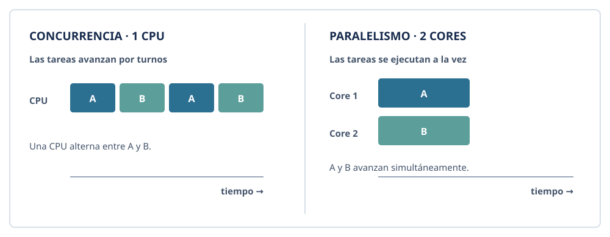
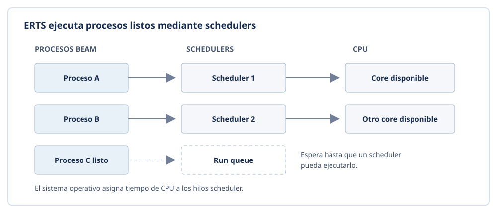

# Paralelismo: niveles y cómo lo implementa la BEAM

En programación es común hablar de concurrencia y paralelismo como si fueran sinónimos. Están relacionados, pero no significan lo mismo:

- **Concurrencia** es estructurar un programa para que varias tareas puedan progresar durante el mismo período. En una sola CPU, el sistema puede alternar entre ellas.
- **Paralelismo** es ejecutar trabajo literalmente al mismo tiempo, por ejemplo en dos núcleos distintos.

Un programa puede ser concurrente sin ejecutarse en paralelo. A la inversa, el paralelismo necesita trabajo que pueda ejecutarse a la vez y recursos de hardware disponibles para hacerlo.

<figure>
  
  <figcaption>La concurrencia organiza varias tareas; el paralelismo las ejecuta al mismo tiempo.</figcaption>
</figure>

La palabra “nivel” puede referirse a la granularidad del trabajo, al recurso que lo ejecuta o a la arquitectura del sistema. No existe una única taxonomía universal; este recorrido separa cuatro escalas útiles y después las conecta con BEAM.

## Cuatro escalas de paralelismo

### 1. Paralelismo de instrucciones

Un núcleo de CPU puede solapar instrucciones independientes de un mismo flujo de ejecución. Por ejemplo, mientras una instrucción espera el resultado de una operación, el procesador puede avanzar otra que no dependa de ese resultado.

Este **paralelismo a nivel de instrucciones** (ILP) ocurre dentro de un núcleo y normalmente lo gestionan la microarquitectura del procesador, el compilador y el runtime de bajo nivel. No significa que una función de Elixir se esté ejecutando en dos cores.

### 2. Paralelismo de datos

En el paralelismo de datos se aplica la misma operación a muchos elementos. Una CPU puede usar instrucciones vectoriales **SIMD** para operar sobre varios valores en una instrucción; una GPU puede ejecutar grandes cantidades de operaciones de datos en paralelo.

Por ejemplo, sumar dos vectores elemento a elemento puede admitir esta forma de paralelismo. No siempre es posible: dependencias entre elementos, ramas diferentes o acceso irregular a memoria pueden impedir o limitar la vectorización.

### 3. Paralelismo de tareas

En el paralelismo de tareas se ejecutan tareas diferentes o partes independientes de un trabajo en distintos núcleos. Cada tarea puede operar sobre datos propios y luego devolver o combinar un resultado.

Los hilos del sistema operativo y los procesos de la BEAM son mecanismos distintos para organizar esa ejecución. En BEAM, un scheduler puede ejecutar un proceso mientras otros schedulers ejecutan otros procesos.

### 4. Paralelismo distribuido

El trabajo también puede repartirse entre distintas máquinas o nodos. Esto aumenta los recursos disponibles, pero el intercambio deja de ser memoria local: necesita red, serialización y manejo de demoras o fallas.

La distribución no es simplemente “más cores”. Un mensaje local y un mensaje a otro nodo pueden tener la misma forma en el código, pero costos y garantías operativas diferentes.

<figure>
  
  <figcaption>Las escalas describen dónde y con qué granularidad ocurre el paralelismo; pueden combinarse en un mismo sistema.</figcaption>
</figure>

## Formas de dividir el trabajo

Las escalas anteriores describen dónde ocurre la ejecución. Para diseñar un programa también hay que decidir **cómo dividir el trabajo**:

- **Por datos:** repartir un conjunto de entradas entre varias tareas que aplican la misma función.
- **Por tareas:** ejecutar actividades distintas que pueden avanzar sin esperar unas a otras.
- **Por etapas (pipeline):** dividir el procesamiento en etapas y permitir que distintas entradas estén simultáneamente en etapas diferentes.

Estas estrategias pueden combinarse. Un pipeline, por ejemplo, puede procesar cada lote en paralelo y distribuir las tareas del lote entre varios cores.

La división no es gratuita. Crear y coordinar tareas, copiar datos, sincronizar resultados y acceder a memoria compartida también cuesta. Si cada tarea hace muy poco trabajo, la coordinación puede salir más cara que ejecutarlo de manera secuencial.

## El límite de la parte secuencial

Aunque una aplicación tenga muchos cores, no todo el trabajo necesariamente puede paralelizarse. La ley de Amdahl expresa una cota idealizada para la aceleración:

```text
speedup(N) = 1 / (s + (1 - s) / N)
```

`N` es la cantidad de unidades de ejecución y `s` la fracción del trabajo que debe ejecutarse secuencialmente. Si el 20 % del trabajo es secuencial, incluso con una cantidad ilimitada de cores la aceleración máxima teórica es `1 / 0.20 = 5`.

En programas reales, la contención por memoria, las tareas desbalanceadas, la comunicación y el costo de crear trabajo paralelo reducen todavía más la ganancia. Por eso “usar todos los cores” no es por sí solo un objetivo: conviene medir el tiempo total y el costo de coordinación.

## Qué significa paralelismo en la BEAM

La BEAM tiene procesos ligeros y schedulers nativos. Los procesos son unidades de trabajo administradas por ERTS; los schedulers son hilos del sistema operativo que ejecutan esos procesos.

En una instancia con varios schedulers online, ERTS puede ejecutar procesos distintos en paralelo. **Un mismo proceso BEAM no se ejecuta simultáneamente en dos schedulers.** Si una operación debe aprovechar varios cores, el trabajo tiene que dividirse en procesos o tareas independientes —o delegarse a una implementación nativa/vectorizada apropiada— y luego combinar sus resultados.

<figure>
  
  <figcaption>Un proceso BEAM no queda ligado permanentemente a un core; los schedulers y el sistema operativo reparten el trabajo.</figcaption>
</figure>

La ilustración supone que hay varios cores disponibles y procesos listos para ejecutar. El sistema operativo decide cómo asignar tiempo de CPU a los hilos scheduler; no hay una correspondencia fija entre cada proceso Elixir y un core.

### Muchos procesos no garantizan paralelismo

Si hay un solo scheduler online o un solo core disponible, la VM puede intercalar muchos procesos, pero no ejecutarlos literalmente al mismo tiempo. Si varios procesos están esperando mensajes o I/O, tampoco están usando necesariamente CPU en ese instante.

Por eso conviene distinguir:

- **Concurrencia de BEAM:** varios procesos independientes pueden avanzar y esperar unos a otros sin tener un hilo nativo dedicado por proceso.
- **Paralelismo de BEAM:** varios schedulers ejecutan procesos listos simultáneamente en distintos recursos de CPU.

Los schedulers reparten el tiempo usando *reductions* y run queues. Si un proceso espera en `receive`, deja de ocupar un scheduler; si queda listo y hay capacidad, otro scheduler puede ejecutarlo. Para una descripción de las colas y el ciclo de ejecución, ver [BEAM por dentro: VM, schedulers y procesos](/elixir/beam-vm-internals/).

### CPU-bound e I/O-bound

El tipo de trabajo importa:

- **CPU-bound:** el proceso pasa la mayor parte del tiempo calculando. Tener varias tareas CPU-bound listas puede aprovechar varios schedulers, hasta que la CPU o la memoria se saturen.
- **I/O-bound:** el proceso pasa mucho tiempo esperando disco, red u otro servicio. Muchos procesos concurrentes pueden mejorar el uso de recursos, pero eso no quiere decir que todos estén calculando a la vez.

Los **dirty schedulers** están pensados para determinados NIFs nativos de larga duración o bloqueantes. No convierten automáticamente el código normal de Elixir en paralelo ni hacen que una llamada nativa ordinaria se ejecute en un scheduler dirty: el NIF tiene que declararse para ese tipo de trabajo.

## Ejemplo: paralelismo acotado con `Task.async_stream`

Para mapear una función costosa sobre entradas independientes, `Task.async_stream/3` puede ejecutar un número limitado de tareas a la vez:

```elixir
results =
  inputs
  |> Task.async_stream(&compute/1,
    max_concurrency: System.schedulers_online(),
    ordered: false,
    timeout: :infinity
  )
  |> Enum.to_list()
```

Cada `compute/1` corre en un proceso de BEAM. `max_concurrency` limita cuántas tareas del stream están activas, y usar el número de schedulers online es un punto de partida para trabajo CPU-bound, no una regla óptima para todo caso. Para tareas que pasan tiempo esperando I/O puede convenir otro límite, siempre teniendo en cuenta el servicio externo y la memoria disponible.

Con `ordered: false`, los resultados pueden llegar en orden de finalización, no en el orden de entrada. El stream devuelve tuplas como `{:ok, result}` o `{:exit, reason}`; la aplicación debe decidir cómo tratar los errores. El timeout también debe elegirse de acuerdo con el trabajo real: `:infinity` evita un límite temporal, pero no sustituye una política de cancelación o recuperación.

Este ejemplo habilita concurrencia y permite que ERTS aproveche varios schedulers si existen cores disponibles. No garantiza una aceleración: si `compute/1` es muy pequeño, si depende de un recurso serializado o si todas las tareas compiten por memoria, la versión paralela puede ser más lenta.

## Cuándo conviene paralelizar

Antes de sumar procesos, conviene preguntarse:

1. ¿Las unidades de trabajo son suficientemente independientes?
1. ¿Cada unidad hace suficiente trabajo para amortizar spawn, mensajes y coordinación?
1. ¿La tarea está limitada por CPU, por I/O, por memoria o por un servicio externo?
1. ¿Hay un límite de concurrencia para evitar saturar el sistema?
1. ¿Cómo se manejan el orden, los fallos, los resultados parciales y la cancelación?

Para código pequeño, secuencial suele ser más simple y rápido. Para trabajo CPU-bound independiente, un conjunto acotado de tareas puede aprovechar múltiples schedulers. Para I/O-bound, la concurrencia puede mejorar la utilización sin que el objetivo sea ocupar todos los cores.

## Conclusión

El paralelismo aparece en varias escalas: instrucciones de CPU, operaciones sobre datos, tareas en una máquina y trabajo distribuido entre nodos. Son formas distintas y combinables, no una sola característica que se active con una palabra clave.

En BEAM, los schedulers ejecutan procesos distintos en paralelo; un proceso individual mantiene un solo flujo de ejecución a la vez. Para aprovechar varios cores hay que expresar suficiente trabajo independiente, mantenerlo acotado y considerar el costo de coordinarlo. Y, como en cualquier plataforma, medir sigue siendo más confiable que asumir que más concurrencia equivale a más velocidad.

## Referencias

- Erlang/OTP, [Processes](https://www.erlang.org/doc/system/eff_guide_processes.html).
- Erlang/OTP, [erl command-line options](https://www.erlang.org/doc/apps/erts/erl_cmd.html).
- Elixir, [Task.async_stream/3](https://hexdocs.pm/elixir/Task.html#async_stream/3).
- Ernesto Bossi, [BEAM por dentro: VM, schedulers y procesos](/elixir/beam-vm-internals/).
